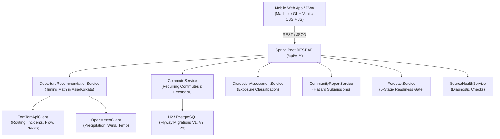

# FlowCast 2.0
### Personal Commute Decision Assistant & Real-Time Mobility Intelligence
*Tailored for Daily Commuters and Students in Visakhapatnam, Andhra Pradesh, India*

[](https://www.oracle.com/java/)
[](https://spring.io/projects/spring-boot)
[](https://maplibre.org/)
[](https://developer.tomtom.com/)
[](https://open-meteo.com/)
[](https://github.com/prmanna78-source/flowcast)
[](https://developer.mozilla.org/en-US/docs/Web/Progressive_web_apps)

---

## 🚀 Product Vision & Overview

**FlowCast 2.0** transforms urban mobility in Visakhapatnam from a passive traffic dashboard into an **active personal commute decision assistant**. 

Instead of showing disconnected traffic speeds and static maps, FlowCast solves the primary daily challenge faced by commuters, office workers, and students:

> **"Help me reach my destination by my required deadline by calculating when I should leave, comparing available routes, explaining real-time road disruptions, and notifying me when travel conditions materially change."**

### Strict Zero-Synthetic Data Policy
FlowCast operates under a **truthful, fail-closed data engineering policy**:
- **Zero simulated data**: FlowCast never injects fake delays, artificial congestion metrics, or generated incident pins.
- **Provider-backed observations**: Every traffic delay, road incident, and weather reading is sourced live from TomTom APIs or Open-Meteo.
- **Auditable ML readiness**: Predictive forecasts remain deliberately disabled until at least 1,000 genuine historical observations are collected and evaluated against walk-forward baseline benchmarks.

---

## 📱 Mobile-First Phone Frontend (PWA)

FlowCast 2.0 is built from the ground up for thumb-friendly one-handed operation on mobile phones (iOS & Android):

- **Docked Bottom Navigation Bar**: 5 key tabs (**Plan** ⏱️, **Commutes** ⭐, **Map** 🗺️, **Hazards** ⚠️, **Status** ⚙️) with active glow indicators and safe-area inset support (`env(safe-area-inset-bottom)`).
- **Bi-Directional ScrollSpy**: The bottom navigation automatically illuminates the active tab as you scroll through the page.
- **Native Bottom Sheets**: Modal dialogs (*Save Commute Profile*, *Trip Feedback*, *Report Hazard*) open as bottom sheets from the bottom edge with grab handles, swipe-down dismiss gestures, and backdrop blur.
- **Horizontal Destination Carousel**: Swipeable landmark shortcuts for Visakhapatnam hubs (🎓 GITAM University, 🏛️ Andhra University, 🚉 Railway Station, 🏢 IT SEZ Rushikonda, 🏖️ RK Beach, 🚏 NAD Junction).
- **2×2 Mathematical Decision Grid**: Visual breakdown displaying `[Recommended Departure] + [Estimated Travel Time] + [Safety Buffer] = [Target Arrival]`.
- **Anti-Trap Map Viewport**: Map container scaled to 320px with custom touch controls preventing users from getting trapped while scrolling on phone viewports.
- **Standalone PWA**: Installable to phone home screens via Web App Manifest with service worker v3 caching (`flowcast-v3-mobile`).

---

## 🌟 Key Capabilities & Features

### 1. Daily Commute Decision Engine
- **Exact Departure Calculation**: Computes departure time down to the minute in `Asia/Kolkata` timezone:
  $$\text{Departure Time} = \text{Target Arrival Deadline} - \text{Live Travel Duration} - \text{Safety Buffer}$$
- **Live Traffic Delay Compensation**: Ingests TomTom live routing duration including real-time congestion delays.
- **Journey Status State Machine**: Dynamically tags your commute as:
  - `READY_TO_DEPART`: Current time is within 15 minutes of recommended departure.
  - `DEPARTURE_UPCOMING`: Departure is scheduled for later in the day.
  - `DEPARTURE_MISSED`: Current time has passed the required departure time.
  - `DISRUPTION_DETECTED`: Major incident or delay detected along the corridor.

### 2. Saved Recurring Commutes ("My Daily Journeys")
- Store regular commutes (e.g., *Home to GITAM*, *Daily Office Commute*) with specific weekdays (`MON,TUE,WED,THU,FRI` or `ALL`).
- **One-Click Live Recalculation**: Re-queries live traffic and recalculates departure instantly.
- **Pause / Resume Toggle**: Temporarily disable commute monitoring during holidays or sick leave.
- **Next Commute Spotlight**: Prominently displays the nearest upcoming journey at the top of the app.
- **Trip Completion Feedback**: Collects commuter feedback on whether the journey was on-time to calibrate future buffer recommendations.

### 3. Interactive Live Traffic Map
- High-performance MapLibre GL raster integration centered on Visakhapatnam (`17.6868° N, 83.2185° E`).
- Real-time TomTom traffic flow density overlay.
- Confirmed incident markers with delay quantification and severity categorization.
- Community hazard markers with distinct visual badges.

### 4. Weather-Aware Journey Disruption Assessment
- Multi-factor exposure model combining live traffic delays, intersecting road incidents, precipitation (mm of rain), and wind speed.
- Classifies corridor exposure into: `LOWER_EXPOSURE`, `MODERATE_EXPOSURE`, `ELEVATED_EXPOSURE`, or `HIGH_EXPOSURE`.
- Delivers actionable, plain-English findings and route recommendations.

### 5. Community Road Hazard Reporting
- Commuter-submitted hazard reporting for potholes, waterlogging, fallen trees, and broken traffic signals.
- In-memory thread-safe store with PostgreSQL persistence fallback.

### 6. Truthful ML Forecast Readiness Pipeline
- Background observation collector logging arterial traffic speeds across Visakhapatnam corridors.
- 5-stage readiness gate preventing false or premature ML forecasts until 1,000+ genuine samples are logged.

---

## 🏗️ System Architecture



---

## 📋 REST API Reference (`/api/v1`)

| Endpoint | Method | Description |
|:---|:---:|:---|
| `/api/v1/departures/calculate` | `POST` | Calculate exact departure time for arrival deadline & route |
| `/api/v1/commutes` | `GET` | List all saved recurring commute profiles |
| `/api/v1/commutes` | `POST` | Save a new recurring commute profile |
| `/api/v1/commutes/next` | `GET` | Retrieve the nearest upcoming scheduled commute for today |
| `/api/v1/commutes/{id}` | `GET` | Get saved commute profile details |
| `/api/v1/commutes/{id}` | `PUT` | Update commute name, target arrival time, buffer, or days |
| `/api/v1/commutes/{id}` | `DELETE` | Delete a saved commute profile |
| `/api/v1/commutes/{id}/toggle` | `POST` | Pause or resume a saved commute |
| `/api/v1/commutes/{id}/recalculate` | `POST` | Recalculate commute departure with live traffic |
| `/api/v1/commutes/feedback` | `POST` | Record voluntary trip completion feedback |
| `/api/v1/commutes/feedback` | `GET` | View trip feedback history |
| `/api/v1/routes/alternatives` | `POST` | Compare alternative route options with live traffic |
| `/api/v1/routes/assessment` | `POST` | Compute weather-aware disruption assessment |
| `/api/v1/places/search` | `GET` | Autocomplete search for Visakhapatnam landmarks |
| `/api/v1/incidents` | `GET` | Active traffic incidents for bounding box |
| `/api/v1/traffic/flow` | `GET` | Live traffic segment speed and flow |
| `/api/v1/weather/current` | `GET` | Real-time weather observations |
| `/api/v1/weather/forecast` | `GET` | 24-hour hourly weather forecast |
| `/api/v1/reports` | `GET` | List active community road hazard reports |
| `/api/v1/reports` | `POST` | Submit a new road hazard report |
| `/api/v1/forecasts/readiness` | `GET` | ML model readiness status & observation progress |
| `/api/v1/sources` | `GET` | Diagnostic health status for all integrated providers |
| `/api/v1/health` | `GET` | System health check and runtime status |

---

## 🛠️ Quickstart & Local Setup

### Prerequisites
- **Java 21 LTS**
- **Apache Maven 3.9+**
- A free **TomTom API Key** from [developer.tomtom.com](https://developer.tomtom.com/)

### 1. Clone the Repository
```bash
git clone https://github.com/prmanna78-source/flowcast.git
cd flowcast
```

### 2. Configure Environment Variables
Copy `.env.example` to `.env`:
```bash
cp .env.example .env
```
Add your TomTom API key in `.env`:
```env
PORT=8088
FLOWCAST_TOMTOM_SERVER_KEY=your_tomtom_api_key
FLOWCAST_TOMTOM_BROWSER_KEY=your_tomtom_api_key
FLOWCAST_TOMTOM_SEARCH_KEY=your_tomtom_api_key
FLOWCAST_OPEN_METEO_ENABLED=true
```

### 3. Build & Run
```powershell
mvn clean compile
mvn spring-boot:run
```

Open your browser to:
```text
http://localhost:8088/
```

---

## 🧪 Automated Test Suite

FlowCast includes 22 automated unit and integration tests covering the entire recommendation engine, commute storage, disruption scoring, community reporting, and REST endpoints.

Run all tests:
```powershell
mvn test
```

### Test Coverage Summary (22 / 22 Passing)
- `ApiControllerTest`: 9 tests verifying departure planning, commute CRUD, next commute lookup, feedback, and health checks.
- `DepartureRecommendationServiceTest`: 2 tests verifying `Asia/Kolkata` timing math, delay compensation, and edge cases.
- `CommuteServiceTest`: 1 test verifying profile persistence, pause toggles, and nearest commute resolution.
- `DisruptionAssessmentServiceTest`: 3 tests verifying weather and delay exposure categories.
- `CommunityReportServiceTest`: 2 tests verifying hazard submissions and sanitization.
- `ForecastServiceTest`: 3 tests verifying fail-closed ML readiness criteria.
- `ApiResponseTest`: 2 tests verifying standardized response formatting.

---

## 📄 License & Attribution
Distributed under the MIT License. Built for the citizens and commuters of Visakhapatnam, Andhra Pradesh, India.
Map tiles and traffic flow &copy; TomTom. Weather data &copy; Open-Meteo.
